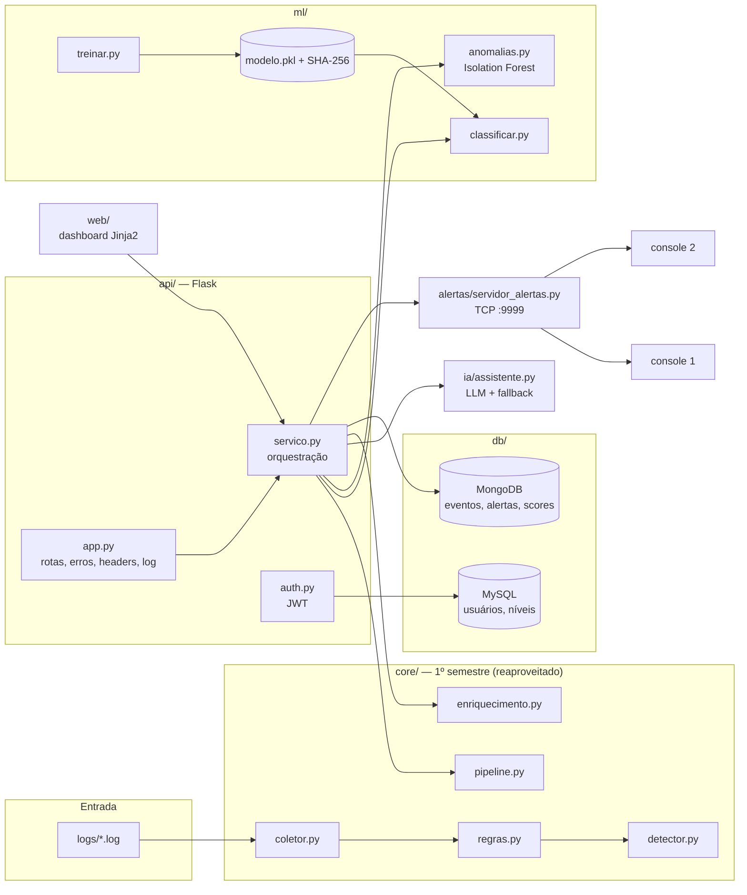

# SecuraPy Platform — SIEM como Plataforma de Segurança

> **Trabalho Final (GS) — 2º semestre · Coding for Security · FIAP**
> Evolução do SecuraPy CLI (1º semestre) para uma plataforma com
> banco de dados, API REST, Machine Learning, dashboard web, LLM e Docker.

## Integrantes

| Nome | RM | Responsabilidade | Módulos |
|------|----|------------------|---------|
| Raul | 572259 | Dashboard/Segurança Web + LLM + integração final | E, G, compose/integração |
| Caio de Oliveira | 571920 | API REST + Docker | D, F |
| Rafael dos Santos | 571199 | Núcleo + Persistência + Machine Learning | A, B, C |

---

## O que a plataforma faz

1. **Coleta** os 3 logs (`auth.log`, `firewall.log`, `web_access.log`) com o núcleo do 1º semestre.
2. **Detecta** ataques com o motor de regras (R001–R006) e o detector (brute force, port scan, blacklist,
   correlação temporal e ameaça consolidada).
3. **Pontua o risco** de cada IP com um classificador treinado (scikit-learn) e um **Isolation Forest** para anomalias.
4. **Persiste** eventos/alertas/scores no **MongoDB** e operadores/permissões no **MySQL**.
5. **Expõe** tudo via **API REST** (Flask + JWT) e um **dashboard web** endurecido (XSS, CSP, CSRF, logging).
6. **Explica** alertas em linguagem natural com um **assistente LLM** (OpenAI ou modo mock), com fallback por regras.
7. **Transmite** alertas críticos em tempo real para consoles TCP (servidor de alertas do 1º semestre).
8. Sobe inteira com **`docker compose up`**.

## Arquitetura



**Camadas:** `core/` não conhece banco nem HTTP; `db/` não conhece regras; `ml/` só recebe eventos;
`api/servico.py` é o único ponto que junta tudo (API e dashboard chamam o mesmo serviço — sem duplicação).

### Estrutura

```
securaPy_platform/
├── core/            coletor, regras, detector, enriquecimento (1º sem) + pipeline.py
├── db/              mongo_repo.py, mysql_repo.py, init.sql
├── ml/              treinar.py, classificar.py, anomalias.py, features.py, modelo.pkl(.sha256), metricas.json
├── api/             app.py, auth.py (JWT), servico.py, validacao.py
├── ia/              assistente.py (LLM + fallback + anti prompt injection)
├── web/             rotas.py, templates/, static/
├── alertas/         servidor_alertas.py, cliente_alertas.py (1º sem)
├── scripts/         ingerir.py, verificar_containers.py, exportar_relatorio.py
├── tests/           70 testes pytest (cenários A1–G4 + funções extras)
├── logs/            logs oficiais da disciplina  ·  logs/exemplos_reais/ = logs do 1º sem (sshd/UFW/Apache)
├── config/          regras.json, blacklist.json
├── saida/           relatorio_exemplo.json (entregável 4)
├── Dockerfile · docker-compose.yml · .env.example · .github/workflows/ci.yml
└── main.py
```

---

## Como executar (Docker — recomendado)

Pré-requisitos: **Docker Desktop** aberto ("Engine running") e **Python 3.12+** (só para os scripts auxiliares e o console de alertas).
Os comandos abaixo são para **PowerShell (Windows)**; no Linux/Mac troque `py` por `python3` e `copy` por `cp`.

> Abra o PowerShell **dentro da pasta do projeto** (botão direito num espaço vazio da pasta → "Abrir no Terminal").
> Confira com `dir`: devem aparecer `docker-compose.yml`, `main.py`, `README.md`.

**1. Configurar o `.env`**

```powershell
copy .env.example .env
py -c "import secrets; print(secrets.token_urlsafe(48))"    # rode 2x: um para JWT_SECRET, outro para FLASK_SECRET_KEY
```

Edite o `.env`: troque as senhas (só letras, números e hífen), cole os dois segredos e defina `ADMIN_EMAIL` /
`ADMIN_SENHA` (8+ caracteres, letras **e** números). **Faça isso antes da primeira subida** — o admin é criado uma única vez.

**2. Subir a plataforma (F1)**

```powershell
docker compose up -d --build     # 1ª vez demora alguns minutos (baixa Mongo, MySQL e Python)
```

**3. Verificar os contêineres (F2 e F3)** — espere ~30 s após subir:

```powershell
py -m pip install docker requests
py scripts/verificar_containers.py      # 3 contêineres running/healthy + /api/saude → 200 → "TUDO OK ✅"
```

**4. Usar**

- Dashboard: <http://localhost:5000> (login com `ADMIN_EMAIL` / `ADMIN_SENHA` do `.env`) → **Analisar logs agora**
- API: <http://localhost:5000/api/saude>
- Consoles de alerta em tempo real (abra 2 PowerShell na pasta): `py main.py console`

**5. Desligar**

```powershell
docker compose down        # para tudo, mantém os dados
docker compose down -v     # para tudo e APAGA os dados (use antes da apresentação para começar do zero)
```

### Testes automáticos (70 testes)

Rode os testes **dentro do Docker** — mesmo Python 3.13 da imagem e com acesso ao MySQL real do compose
(os testes de MySQL B3/B4 rodam de verdade). Com a plataforma no ar:

```powershell
docker compose run --rm -v "${PWD}:/app" api sh -c "pip install --user pytest mongomock && python -m pytest -q"
```

Resultado esperado: **`70 passed`**. O contêiner é temporário (`--rm`) e não afeta a plataforma em execução.

> Rodar com o Python do Windows (`py -m pip install -r requirements-dev.txt` e `py -m pytest -v`) também funciona,
> mas os 3 testes de MySQL são pulados (o banco do compose não é exposto fora da rede interna) e, em versões muito
> novas do Python (3.14), o carregamento do scikit-learn pode travar — por isso o comando acima é o recomendado.

### Problemas comuns

| Sintoma | Causa / solução |
|---|---|
| `pip` não é reconhecido | Use `py -m pip ...` e `py ...` no lugar de `pip` / `python` |
| `verificar_containers.py` mostra "(não encontrado)" | A plataforma não está no ar: `docker compose up -d` |
| api fica `created` ou reiniciando | `docker compose start api` e veja o erro em `docker compose logs api --tail 40` |
| "Credenciais inválidas" com a senha certa | O admin foi criado antes de você editar o `.env`. Rode `docker compose down -v` e `docker compose up -d` (confira em `docker compose logs api \| Select-String admin` a linha "Usuário admin inicial criado") |
| "Muitas tentativas" no login | 5 erros seguidos bloqueiam o email por 5 min (anti força bruta) |
| `port is already allocated` | Porta 5000 ou 9999 ocupada: no `docker-compose.yml` troque para `"8080:5000"` / `"9900:9999"` e use `localhost:8080`; para o console: `$env:ALERTAS_PORTA="9900"` antes de `py main.py console` |
| Terminal "congelado" / Ctrl+C não funciona | O PowerShell entrou em modo seleção (clique na janela). Aperte **Esc** ou **Enter** |

### Fluxo ponta a ponta (roteiro do vídeo) — PowerShell

```powershell
# 1. login → token JWT (use o ADMIN_EMAIL / ADMIN_SENHA do seu .env)
$login = Invoke-RestMethod -Method Post http://localhost:5000/api/login -ContentType "application/json" `
  -Body '{"email":"admin@cybershield.com","senha":"SUA_ADMIN_SENHA"}'
$h = @{ Authorization = "Bearer $($login.token)" }

# 2. com 2 consoles abertos (py main.py console), dispare a análise
Invoke-RestMethod -Method Post http://localhost:5000/api/analisar -Headers $h -ContentType "application/json" -Body '{}'

# 3. consultas
Invoke-RestMethod "http://localhost:5000/api/alertas?severidade=critica&pagina=1&tamanho=5"   # D1
Invoke-RestMethod http://localhost:5000/api/ip/185.220.101.1                                  # D2
curl.exe -s -o NUL -w "%{http_code}`n" -X POST http://localhost:5000/api/alertas                # D3 → 401
curl.exe -s -w "`n" -X POST http://localhost:5000/api/alertas -H "Authorization: Bearer $($login.token)" -H "Content-Type: application/json" -d '{\"ip\":\"x\"}'   # D4 → 400
curl.exe -s http://localhost:5000/api/ip/999.1.1.1                                              # D5 → 400
curl.exe -sI http://localhost:5000/login                                                        # E2: 3 headers de segurança
```

> No PowerShell use `curl.exe` (o `curl` sozinho é um apelido de outro comando).

Depois, no dashboard: busque `185.220.101.1` (geo + score ML 97.9 + explicação do LLM), cadastre em **Alertas** um
alerta com descrição `<script>alert(1)</script>` e mostre que aparece como texto (E1).

### Execução local sem Docker (desenvolvimento)

```bash
pip install -r requirements-dev.txt
export MONGO_URI=mongomock://            # MongoDB em memória (dados somem ao encerrar)
export MYSQL_HOST=localhost MYSQL_USER=securapy MYSQL_PASSWORD=... MYSQL_DATABASE=securapy
export ADMIN_EMAIL=admin@cybershield.com ADMIN_SENHA=Admin12345
python main.py api        # http://127.0.0.1:5000
python main.py demo       # só núcleo + ML + LLM no terminal, sem banco
python main.py treinar    # re-treina o modelo (gera novo hash e métricas)
```

### Dependências

Python 3.13 · Flask 3.1 · gunicorn · pymongo · PyMySQL (+ cryptography p/ MySQL 8) · PyJWT · scikit-learn 1.9.1 /
numpy 2.5.3 / joblib 1.6.0 (**versões fixas**: o `modelo.pkl` depende delas) · requests · docker (SDK) ·
pytest + mongomock (dev). Imagens: `python:3.13-slim`, `mongo:7`, `mysql:8.4`.

---

## O que foi reaproveitado do 1º semestre

| Arquivo do 1º sem | Onde está | O que mudou (e por quê) |
|---|---|---|
| `coletor.py` | `core/coletor.py` | Parsers sshd/UFW/Apache **mantidos**; adicionado o formato `chave=valor` dos logs oficiais, `timestamp_iso` (consulta por período e correlação temporal), `parsear_linhas()` para lotes da API; `print` → `logging` |
| `regras.py` | `core/regras.py` | Mesmo motor; nova regra **R006 SQLi**; URL lida inteira (antes era cortada no 1º espaço e escondia `' OR '1'='1`); padrões case-insensitive |
| `detector.py` | `core/detector.py` | Mesmas funções com dict/set; faixas de severidade alinhadas aos cenários oficiais; blacklist vinda de `config/blacklist.json`; **bônus** `detectar_brute_force_janela()` |
| `enriquecimento.py` | `core/enriquecimento.py` | `ipaddress` no lugar do parsing manual; token no header (não na URL); cache com TTL; modo offline |
| `servidor_alertas.py` / `cliente_alertas.py` | `alertas/` | Mesmo servidor multi-thread; host/porta por env; `iniciar_em_background()` para a API transmitir alertas |
| `main.py` (menu, opção 1) | `core/pipeline.py` + `api/servico.py` | O fluxo da opção 1 virou uma função reutilizável |
| `relatorios.py` (exportar JSON) | `api/servico.relatorio_completo()` + `GET /api/relatorio` | O dashboard CLI foi substituído pelo dashboard web |
| `config/regras.json`, `logs/` | `config/`, `logs/exemplos_reais/` | Logs realistas do grupo mantidos como 2º dataset (também usados no treino do ML) |

> **Sobre os dados de teste:** os cenários da GS (58 eventos = 23 + 17 + 18) usam os logs oficiais da disciplina,
> que ficam em `logs/`. O `auth.log` oficial tem **11** linhas FAIL de `185.220.101.1` (o enunciado cita 10);
> a severidade resultante é ALTA, como esperado.

---

## Decisões de segurança

| Risco | Defesa | Onde |
|---|---|---|
| SQL Injection (B4) | 100% queries parametrizadas `%s` | `db/mysql_repo.py` |
| NoSQL Injection | filtros montados campo a campo (lista branca), nunca o dict do usuário | `db/mongo_repo.py` |
| Senha em texto puro | hash scrypt/pbkdf2 com salt (werkzeug) | `db/mysql_repo.py` |
| Enumeração de usuários (E3) | mesma mensagem e mesmo custo (hash fictício) p/ usuário inexistente e senha errada | `mysql_repo.autenticar` |
| Força bruta no login | 5 falhas / 5 min por IP+email → 429 | `api/auth.py` |
| Token forjado | JWT HS256 com `exp/iss/aud`, algoritmo fixo (bloqueia `alg: none`) | `api/auth.py` |
| XSS (E1) | Jinja2 autoescape, nenhum `|safe`, CSP sem `unsafe-inline` | `web/templates` |
| Clickjacking / MIME sniffing (E2) | `X-Frame-Options: DENY`, `X-Content-Type-Options: nosniff`, CSP | `api/app.py` |
| CSRF | token por sessão em todo formulário POST; cookie HttpOnly + SameSite | `web/rotas.py` |
| Path traversal em `/api/analisar` | caminho resolvido com `realpath` e preso à pasta `logs/` | `api/servico.py` |
| Vazamento em erro 500 | traceback só no log do servidor; cliente recebe `{"erro":"Erro interno"}`; banco fora → 503 | `api/app.py` |
| Falha de log (OWASP A09) | 1 linha por requisição em `var/acesso.log` (sem tokens nem corpo) | `api/app.py` |
| Modelo adulterado (C4) | SHA-256 conferido **antes** do `joblib.load` (pickle executa código) | `ml/classificar.py` |
| Prompt injection (G4) | log tratado como dado delimitado; saída validada contra rótulos fixos; LLM **nunca rebaixa** a classificação das regras | `ia/assistente.py` |
| Dados sensíveis para o LLM | senhas, tokens, e-mails, usuários e IPs internos mascarados | `ia/assistente.anonimizar` |
| Segredos no código | tudo em `.env` (fora do Git); bancos sem porta publicada; contêiner da API sem root | `.env.example`, compose, Dockerfile |

---

## Machine Learning

- **Features por IP** (`ml/features.py`): falhas de login, logins OK, usuários distintos, portas distintas, bloqueios,
  erros web, total web, alertas de regras, presença em blacklist, IP privado.
- **Dataset:** os IPs reais dos dois conjuntos de logs (rotulados pelo núcleo) + amostras **sintéticas** com seed fixa
  (perfis normais e de ataque, incluindo casos ambíguos de propósito: usuário que erra a senha e ataque "low and slow").
  Sem isso, 14 IPs não bastariam para treinar.
- **Modelo:** `Pipeline(StandardScaler + RandomForest)` escolhido contra Regressão Logística por F1 em validação cruzada
  estratificada de 5 folds. Métricas em `ml/relatorio_metricas.txt` / `ml/metricas.json`
  (F1 ≈ 0,99). Como a maior parte dos dados é sintética, essas métricas medem a separação dos perfis
  simulados — não o desempenho em produção.
- **Resultado nos cenários:** `185.220.101.1` → score 97,9 / ataque (C2); `192.168.1.10` → 0,4 / normal (C3).
- **Bônus:** Isolation Forest treinado só com tráfego normal marca os 3 IPs maliciosos como anômalos.

## Assistente LLM

`classificar_evento(evento)` → `{"classificacao": "NORMAL|SUSPEITO|CRÍTICO", "explicacao": ..., "origem": "llm|fallback|mock"}`.
Com `OPENAI_API_KEY` usa a OpenAI (`temperature=0.1`, saída JSON); sem chave roda em **modo mock** (regras), com a mesma
interface. Qualquer erro de rede, timeout ou resposta fora do formato cai no fallback.

---

## Cenários de teste → onde são verificados

70 testes — rode com o comando da seção [Testes automáticos](#testes-automáticos-70-testes). Também rodam no GitHub Actions com MySQL real (`.github/workflows/ci.yml`).

| Cenário | Teste |
|---|---|
| A1–A4 | `tests/test_nucleo.py::test_a1…test_a4` |
| B1, B2 | `tests/test_persistencia.py::test_b1…, test_b2…` (+ idempotência, índices, filtros) |
| B3, B4 | `tests/test_persistencia.py::test_b3…, test_b4…` (MySQL real) · B3 via API: `test_api.py::test_gestao_de_usuarios_admin` |
| C1–C4 | `tests/test_ml.py` |
| D1–D5 | `tests/test_api.py` (+ JWT expirado/`alg none`, 403, 500 sem vazamento, 503) |
| E1–E4 | `tests/test_web.py` |
| F1–F3 | `docker compose up` + `scripts/verificar_containers.py` |
| G1–G4 | `tests/test_assistente.py` (LLM simulado por injeção de dependência) |
| Tempo real (2 consoles) | `tests/test_alertas_tcp.py` |
| Funções extras (upload, Ao vivo, chat, diagnóstico, Telegram) | `tests/test_extras.py` |

## Bônus implementados

| Bônus | Onde |
|---|---|
| Isolation Forest (+0,3) | `ml/anomalias.py`, coluna "Anomalia" no dashboard |
| Correlação temporal (+0,2) | `core/detector.detectar_brute_force_janela` → alerta C004 |
| Testes + CI (+0,3) | `tests/` (70 testes) + `.github/workflows/ci.yml` |
| JWT completo (+0,2) | `api/auth.py` |

## Funções extras

Além do que o enunciado pede, a plataforma tem recursos pensados para o dono de uma pequena empresa, que não é técnico:

| Função | Onde fica | O que faz |
|---|---|---|
| Analisar um arquivo de log | Dashboard → "Analisar um arquivo de log seu" (nível 3+) | Envia um `.log`/`.txt` (até 2 MB) nos formatos SSH, UFW, Apache/Nginx ou o da disciplina; o tipo pode ser detectado sozinho |
| Tela **Ao vivo** | Menu → Ao vivo | Painel que se atualiza a cada 2 s, com nota de saúde da segurança (0–100), últimos alertas e botão **Analisar com IA**, que gera um boletim em português simples |
| **Pergunte à IA** | Menu → Pergunte à IA | Chat: "Fui atacado?", "Quem é o mais perigoso?", "O que eu faço agora?" — responde só com os dados reais do sistema |
| **Diagnóstico** | Página do IP → "Diagnosticar com IA" | Diz qual ponto fraco o atacante tentou explorar e como corrigir (ex.: configuração do SSH) |
| Alertas no **Telegram** | Menu → Conectar | Manda os alertas CRÍTICOS para o celular, com limite anti-spam (1 por atacante a cada 2 min, máx. 10/min) |
| Coletor para servidor real | Menu → Conectar · `scripts/coletor.py` | Acompanha os logs de um servidor Linux e envia ao SecuraPy em tempo real |
| Simulador de ataque | `scripts/simular_ataque.py` | Gera tráfego normal e ataques em tempo real para demonstrar a tela Ao vivo |
| Gerador de log | `py scripts/gerar_log.py [--sucesso] [--ataques sqli xss ...]` | Cria um arquivo `.log` realista (SSH, UFW, Apache) com tráfego normal + os ataques escolhidos, para testar o upload |

**IA:** com `GEMINI_API_KEY` no `.env` (ou `OPENAI_API_KEY`), o assistente, o boletim, o chat e o diagnóstico usam o modelo de
linguagem; sem chave, tudo funciona por regras (modo mock). As mesmas proteções do Módulo G valem para todos: dados
sensíveis mascarados (inclusive o histórico do chat), conteúdo dos logs tratado como dado não confiável e fallback quando
a IA falha. O boletim e o diagnóstico guardam a resposta por alguns segundos para poupar a cota da IA, mas refazem na hora
quando chega um alerta novo.

**Segurança das telas novas:** todo texto vindo dos logs é escrito com `textContent` (nunca `innerHTML`), todos os
formulários `POST` exigem token CSRF, e apagar os dados da tela Ao vivo exige nível 5 (admin).

## Referência rápida da API

| Método | Rota | Auth | Descrição |
|---|---|---|---|
| GET | `/api/saude` | — | status dos componentes |
| POST | `/api/login` | — | `{"email","senha"}` → JWT |
| GET | `/api/eventos` | — | `fonte, tipo, ip, inicio, fim, pagina, tamanho` |
| GET | `/api/alertas` | — | `severidade, ip, regra_id, pagina, tamanho` |
| GET | `/api/alertas/<id>` | — | id = SHA-256 (64 hex) |
| POST | `/api/alertas` | nível 3 | `{"ip","severidade","regra_nome","descricao"}` |
| POST | `/api/analisar` | nível 3 | `{}` · `{"pasta":"exemplos_reais"}` · `{"caminho":"auth.log"}` · `{"eventos":[{"fonte","linha"}]}` |
| GET | `/api/ip/<ip>` | — | eventos + alertas + geo + score ML + explicação LLM (`?llm=0` desliga) |
| GET | `/api/resumo` | — | dados do dashboard |
| GET | `/api/relatorio` | nível 1 | exportação JSON completa |
| POST | `/api/assistente/classificar` | nível 2 | `{"evento":{...}}` ou `{"texto":"..."}` |
| GET | `/api/ml/status` | — | integridade + métricas do modelo |
| GET/POST | `/api/usuarios` | nível 5 | gestão de operadores |

Níveis de acesso (tabela `niveis_acesso`): 1 leitura · 2 analista jr · 3 analista · 4 líder · 5 admin.

## Limitações conhecidas

- O servidor TCP de alertas roda dentro do processo da API (gunicorn com 1 worker + 8 threads) e não tem autenticação
  nem TLS — adequado ao laboratório, não à produção.
- O limitador de tentativas de login fica em memória (zera quando a API reinicia).
- Métricas do ML são majoritariamente sobre dados sintéticos (ver seção ML).

## Licença

MIT — ver [`LICENSE`](LICENSE).
